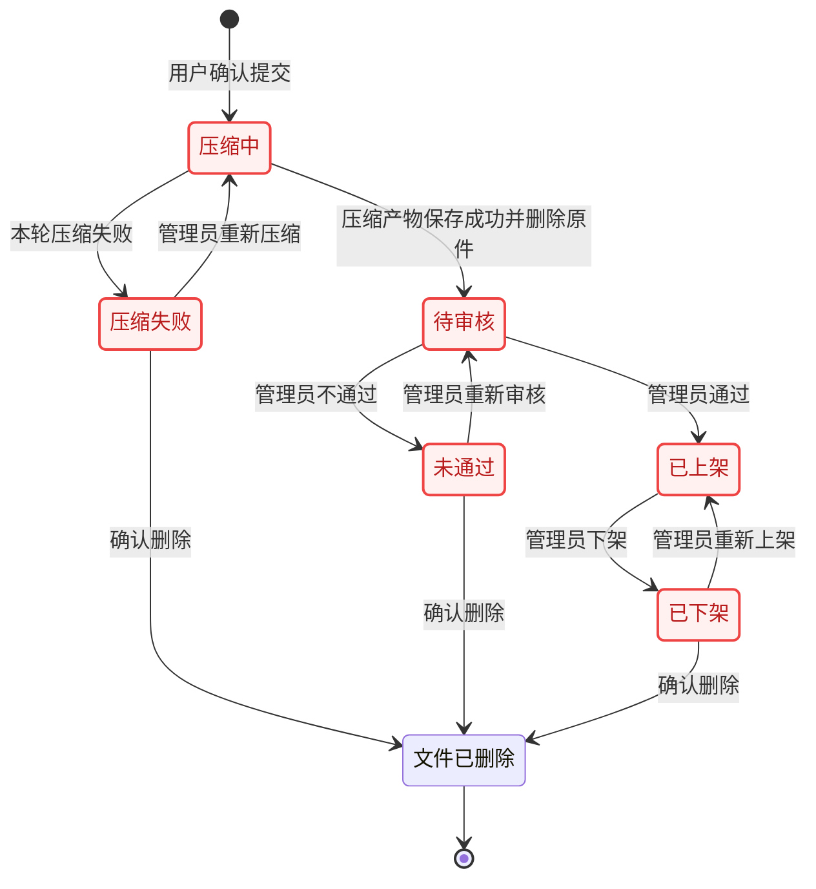

# 记忆功能技术方案

> 版本：v4.1 人工审核版，2026-10-11。
> 基线：497dfd0，保留分支 merge/boardgame-library-into-memory；开发分支 feature/memory。
> 依据：prototype/龙城小程序.pen 的最新记忆、投稿、公开预览、内容审核状态。
> 本地实现与自动化验证中；不部署、不迁移生产数据库、不修改登录密钥。尚未完成真机验收，不能视为可直接上线。

## 1. 产品约定

### 已确认

| 项目 | 规则 |
| --- | --- |
| 投稿与发布 | 用户投稿不直接公开；管理员审核后代为发布 |
| 审核方式 | 图片、视频、文字统一由管理员人工审核；处理完成直接进入待审核，不接微信自动检测或检测回调 |
| 媒体 | 图片、视频任意混合，每条合计最多 10 个，允许全部为视频；不另设视频数量上限 |
| 图片上限 | 每张原文件压缩前最多 20MB，先校验再压缩，不能靠压缩绕过原文件上限 |
| 视频上限 | 每个原文件压缩前最多 20MB、30 秒，先校验再压缩，不能靠压缩绕过原文件上限 |
| 数量与标识 | 数量不区分图片/视频；播放图标按原型保留 |
| 身份展示 | 公开预览显示投稿人的头像和昵称；管理员是审核及发布操作者，不替换作者身份 |
| 存储 | 使用现有服务器，设置严格容量保护；暂不开通 COS/CDN |
| 总容量 | 用户确认 10GB，即 10,000,000,000 字节；包括原文件、处理产物及进行中预留，不代表服务器现在已有这么多可用空间 |
| 导航 | 第二个 Tab 从工具改为记忆；首页桌游库、Chwazi 入口保留 |
| 中央加号 | 记忆 Tab 内进入投稿；其他 Tab 仍新建活动 |
| 投稿权限 | 仅 user、admin 可投稿；匿名和 guest 可浏览已发布内容，不能投稿 |
| 个人额度 | 不设置个人每日条数或累计上传量上限，仍遵守每条 10 项和单文件限制 |
| 清理 | 已投稿的文件不自动清理，由管理员决定；不得因容量满自动删内容 |
| 部分发布 | 管理员可挑选同条投稿中的部分内容发布，其余保持不公开 |

### 沿用旧方案与原型

- 位置、关联活动、备注均非必填；备注最多 50 字。
- 未发布内容不出现在公开列表、详情或分享入口，包括投稿人本人。
- 首版不做我的投稿列表、结果通知、评论、点赞、收藏；审核结果沿用线下沟通。
- 保留原型里的记忆分享入口；不改现有活动分享功能。
- 审核必须支持逐项选择；公开记忆只包含选中项，未选中项不出现在封面、详情或资源读取中。
- 其他未确认的运营参数均明确标为建议，不能当成用户已同意。

## 2. 原型核查

本次读取了当前原型的 21 个记忆/内容审核顶层页面与状态，以及我的管理员入口，并查看代表性截图。仅做读取与截图，没有调用原型修改 API。

| 模块 | 代表节点 | 落地内容 |
| --- | --- | --- |
| 记忆列表 | D3WX9 | 双列瀑布流、封面、点击预览、记忆 Tab |
| 投稿表单 | je1iX、nOSnP | 横滑媒体、末尾随列表滑动的添加入口、逐个删除、上传进度、位置、活动、50 字备注、上传 |
| 投稿说明 | CXmSf | 点击上传先确认；取消保留表单，确认才上传投稿；复用统一居中弹窗 |
| 图片预览 | ptSzf、TVIe9 | 等比完整适配/黑边、作者、备注、位置、关联活动、分享 |
| 图片放大 | l2Ubhx、VzzYQ | 放大时隐藏信息及裁决，只保留还原和必要返回入口 |
| 视频预览 | U8Nbr、WdzA7、A0ClSv | 暂停/播放、进度拖动、横版黑边、横屏入口 |
| 横屏播放 | qV8N5、W9qcw、NKGiz、TYBwe | 播放/暂停、快进/快退、进度、退出横屏，不放审核裁决 |
| 审核列表 | ZDNWD、ZG2ZJ、Qg9ug | 待审、备注展开/收起、通过/不通过、空状态 |
| 审核预览 | yxYd9、xuqNi | 复用同一媒体查看器，加审核权限和裁决区 |
| 管理入口 | lRVYf | 我的页仅管理员显示内容审核与待审数量 |

最新原型已移除图片上一张/下一张悬浮箭头，实施时使用滑动，不恢复旧方案的箭头。审核专用横屏页面已移除，但审核视频仍有横屏入口：复用同一横屏播放器，不新增另一套页面。

### 图标来源

全部新增图标使用 Pencil 官方导出的 SVG 路径，保留原始 viewBox，不手绘、不使用近似图标、不额外加描边。底部记忆图标来自 Z50zWz 的 Material Symbols Rounded `photo_library`，不是 Lucide `images`。未选中状态只复用同一路径调整为导航的未选中颜色，不改变几何形状。页面尺寸按 390px 原型换算，底部导航保持原型的 18px 固定图标框。

返回图标来自 QJrbo/wdlHP，播放来自 nD9ML/FqNgW，添加来自 MG20F，选择箭头来自 sJS7t，分享来自 GmDYb，审核盾牌来自 pspZn，活动/位置来自 ZO85Z/X6BLn，横屏/还原来自 oUYuN/b9ym8V，移除按钮复用原型 e92MIb。横屏返回、退出、快进、快退分别来自 jikiT/gdD4E/g42w7/yKJO5。19 个导出文件保留 `data-pencil-id`；自动化测试校验路径摘要，防止后续被近似素材替换。

占位作者、旧导航标题、示例日期和素材文件大小不是业务规则，例如 88.4MB 的审核示例不能覆盖本轮确认的 20MB 上限。旧方案的左滑快进、右滑快退在交互小样中一并验收。

原型尚未完整覆盖混合媒体计数、压缩/上传进度、处理失败、容量满和下线状态；本轮又确认了逐项选取发布，因此需要补充媒体选中态、选择数量和发布确认，并确认手动清理入口。只补这些需求对应状态，不自行增加业务模块。原型在核查期间有新的保存变动，保留这些变动，不回退用户编辑。

## 3. 架构和改动边界

沿用原生小程序 JS/WXML/WXSS、Skyline、FastAPI、SQLAlchemy、Alembic、MySQL、Pillow 和现有部署结构。

主流程：选择原文件并校验 -> 投稿确认 -> 创建上传会话 -> 逐个上传原文件 -> 提交 -> 服务端校验与压缩 -> 管理员人工审核、选取发布 -> 公开展示。

为使服务端也能真正执行压缩前上限，首版上传通过校验的原文件，再在服务端压缩；不默认先在手机压缩后上传并仅凭客户端申报原大小。否则服务端无法从压缩产物证明原文件是否越限。

### 小程序

- 主包新增记忆 Tab 页面 pages/memory/memory；Tab 页不放分包。
- 当前新增 pages/memory_create、pages/memory_detail、pages/memory_review；公开预览和审核预览复用同一详情页面，审核模式只增加权限及裁决区。上线前按实测主包体积决定是否拆普通分包，不复制原型大图进主包。
- 普通 JSON 请求沿用 services/request.js；上传另做控制器，支持进度、取消、失败重试、鉴权及请求追踪，不改变全局请求默认超时。
- 中央加号按当前 Tab 分派操作，各自使用对应权限提示，不能让其他页面的加号变成投稿。
- 工具页不再作为 Tab 后，若保留其入口，改用适用的普通页导航；首页桌游库和 Chwazi 入口及工具内部跳转必须回归。

### 后端

- 独立记忆 model/schema/router/service、媒体处理模块和维护脚本。
- 上传请求只做有界落盘和记录，不在请求内长时间转码。
- 独立记忆 worker 领取数据库待处理媒体，处理状态、租约、有限重试持久化，进程重启能恢复。
- 不新增 Redis/Celery，不复用或修改桌游库专用 job 表与 worker。
- 新增 FFmpeg/ffprobe 系统依赖，负责真实视频校验、兼容化、压缩与封面；安装留到批准后的部署步骤。
- JWT 密钥、算法和有效登录会话不变。私有媒体使用独立签名密钥，不复用用户登录令牌。

## 4. 上传与压缩

### 4.1 选择与表单

1. wx.chooseMedia 使用 mix，count 按剩余数量计算；拍摄 maxDuration 设为 30 秒，选择原始文件，不先使用 compressed 产物做上限判断。
2. 相册视频必须另查真实时长：maxDuration 只限制拍摄，不能作为相册过滤器。
3. 保留选择顺序，每项有稳定本地 ID；支持预览、移除、继续添加。首版不另加拖动排序。
4. 检查所选原文件的实际字节和时长，图片、视频每个原文件超过 20MB 或视频超过 30 秒即拦截。点击上传先弹投稿说明；确认后才创建会话并发送原文件。
5. 图片和视频的 20MB 都是压缩前原文件上限，不是压缩目标。服务端有界接收原文件并重新核验真实字节/时长，不信声明，也不接受先压缩来绕过此规则。
6. 超过 30 秒提示换较短视频，不自动裁剪；超过大小提示换合规原文件，不自动先压到上限以内再接收。服务端压缩失败显式提示待处理，不以失败为理由直接公开原文件。
7. 备注统一 Unicode 计数，前后端一致，覆盖 emoji，不能简单用 UTF-16 长度把一个补充平面字符计成两个。

### 4.2 图片算法

- 客户端读取原文件大小和尺寸，不先压缩以绕过 20MB 限制；服务端接收原文件后再次按实际字节校验。
- Pillow 实际解码、校正方向、限制总像素、保持比例不放大、移除 EXIF/GPS，产出展示图和缩略图。
- 建议展示长边 1920px、缩略长边 600px。JPEG 初始质量 85，结合实际产物大小逐步降低质量/长边，最多三轮，避免无限处理和明显失真。
- 照片用 JPEG，透明图用 PNG；PNG 采用缩尺寸和无损优化，不把 JPEG quality 参数假定为对 PNG 同样有效，不悄悄丢透明，不重新引入 WebP。
- 压缩目标是在可接受清晰度下进一步减小体积，不是把不合规原文件压到 20MB。建议每张展示图争取约 0.5～1.5MB，仅是样本调优目标，不承诺所有图片都到固定大小。图片展示图及缩略图合计的处理预算仍为 10MiB，与原文件上限分开，不随输入上限扩大。
- 用照片、细字、暗部、透明边缘验收后定参数。产物不得不受控膨胀；压缩成功后以最终媒体替换临时副本，不长期存重复原图。这是格式处理，不是自动删除业务投稿。
- 仅处理投稿媒体产物，不覆盖原型、设计源文件或现有图片资源。

### 4.3 视频算法

- 客户端选择并检查压缩前原文件，超过 20MB 或 30 秒直接拦截，不先 wx.compressVideo 来凑上限。
- 服务端有界接收原文件，ffprobe 核对实际容器、编解码、时长、尺寸、音视频流；不信扩展名、MIME 或客户端 duration。
- FFmpeg 初始目标为 H.264/AAC MP4、720p 上限、最多 30fps、CRF 约 26、maxrate 约 2Mbps、AAC 96kbps、faststart；保持比例、不放大，参数经样本验收再定。
- 30 秒视频约 2Mbps 时，体积通常可望降到约 8MB 量级，这是估算而非承诺；视频原文件 20MB 是准入限制，不是压缩后的期望大小。
- 当前统一转为标准输出，以便核验编码和体积；兼容小视频的免重编码尚未实现。不改变时长、不拉伸、不丢原有音轨，无音轨视频正常支持。
- 产物要可解码且大小受控，失败有限重试，不能无限转码或静默公开原片。封面由服务端提取，不用另一张上传图替代视频校验。
- 成功后以压缩产物替换临时副本，不保留冗余原片；原始输入与中间产物存在期间都计入容量。
- 一次处理一个文件、一个视频任务，限制线程、时间、CPU、内存；不能抢占预约接口和桌游库任务。

### 4.4 上传可靠性

微信官方 UploadFileOption 是单个 filePath/name，不沿用旧方案的一次 files[] 上传多个文件。每项单独 wx.uploadFile，建议并发 2，失败只重试失败项；进度按实际字节加权。

会话按用户隔离，用 client_submission_id 防双击创建多条；媒体槽位唯一，同内容重试幂等，不同内容占同一槽位返回冲突。提交时检查所有文件完成、冻结顺序和表单；投稿后不能继续替换内容。

选择文件并通过原始大小、时长检查后，立即预上传到服务器私有临时会话；用户仍可填写表单、继续添加和逐个删除文件。最后点击“上传”并确认才提交审核；若尚有文件在传，等待完成，成功文件不重复传输。图片/视频原文件仍在服务端收到后压缩，不在选择时先压缩原片。

每项使用本次会话内不复用的稳定槽位，声明时预留原文件和处理预算；删除会中止该项传输、删除私有临时文件并释放预算。服务端串行处理同一会话的声明、写入、删除和最终提交，删除槽位保留最小标记，防止迟到请求重新写入。删除失败必须重试成功后才允许提交，不能把页面已删的内容夹带投稿。

返回投稿页之外会尽力取消未提交会话；断网、强退、进程崩溃导致取消请求丢失时，独立记忆 worker 自动回收超过 24 小时无上传操作的未提交会话，包括不完整文件与容量预留。只回收 draft，不触碰已提交的 processing、pending、published、rejected、offline 或 failed。此临时文件规则不改变业务投稿由管理员手动清理的约定。

首版不承诺跨设备草稿、关闭页面后续传或单文件字节级断点续传。当前页面可重试失败项，单文件上传回执丢失时先确认槽位状态，避免重复传成功文件；最终提交回执丢失时冻结表单并幂等重试提交，不重复生成投稿。

## 5. 私有存储与容量保护

### 5.1 隔离和访问

文件放独立私有根目录，例如 backend/private-storage/memories，必须在现有 media_root 与 Caddy 静态根之外。现有 /media 是公开挂载，待审文件不能放进去，随机文件名也不是权限控制。

- 公开媒体接口每次检查记忆为 published 且该媒体被选中发布；只检查整条记忆状态会泄露未选中内容，必须两层校验。
- 管理员预览用短效签名地址，绑定媒体 ID、展示版本、有效期和审核者；每次还查其当前管理员权限与记忆状态。
- 视频支持 GET/HEAD、Range/206、正确类型/长度/缓存头；实测进度拖动和横屏续播。
- 私有资源禁止公共缓存；首版公开资源也不做长期 CDN 缓存，下线后接口停止读取。已被下载的文件不能远程收回。
- 日志不记录 JWT、签名、OpenID、完整备注和精确位置，另外检查 Caddy 查询参数脱敏。

### 5.2 实际空间与确认额度

2026-10-10 23:44（香港时间）通过 SSH 只读查询：根分区可用 8,331,718,656 字节，即约 7.76GiB（8.33GB）；磁盘使用率 84%，inode 使用率 20%。项目目录约占 1.3GiB。没有执行清理、部署或重启。

可用空间不能全部分给记忆，还需服务运行、转码中间文件以及唯一正式备份的替换峰值；尤其图片/视频压缩后的文件做备份通常不会再大幅变小。用户已确认总额 10GB。该业务上限大于上次实测可用空间，运行时仍受磁盘剩余空间限制；不能保证现有磁盘可实际存满 10GB，上线前须重新核对空间及备份峰值。

| 项目 | 当前规则 |
| --- | --- |
| 全部记忆硬上限 | 10GB（10,000,000,000 字节），包含暂存、原始上传、展示/缩略/封面、中间文件及进行中预留量 |
| 草稿/处理/待审额度 | 与所有状态共享总额，不另设 512MiB 上限 |
| 磁盘保底 | 可用空间低于 3GiB 拒绝新投稿；发布前按转码/备份峰值重新核定 |
| 每用户日额度 | 不限制条数/累计量；并发、请求防滥用和服务器容量保护不属于个人每日额度 |
| 未提交临时文件 | 删除文件/退出投稿页主动释放；异常遗留在 24 小时无上传操作后自动回收，释放文件和容量预留 |
| 已发布内容 | 不自动删除；满额时停止新投稿，管理员决定清理/扩容 |
| 待审内容 | 不按年龄自动删除；满额时暂停新投稿并提示处理 |
| 不通过/未选用/已下线 | 不设置自动删除期限，由管理员手动决定，最小审核记录保留 |

允许 10 个都是视频，单条理论最大为 200MB；不继续沿用旧草案的单条 100MB 限制。即使单文件合规，也不能绕过全局容量限制。

MySQL 短锁串行预留全局额度，预留记录在记忆/媒体字段；接收前预留，写入时限制实际字节，中间产物另预留。不能先写满硬盘再统计，也不能仅用进程内锁应对多 worker。

手动清理先预览具体媒体、所属投稿、状态和可释放大小，管理员确认后才认领及删除；已发布媒体必须先下线，不能通过清理按钮直接删掉公开内容。路径限制在记忆私有根内，重复操作幂等。定期核对账本与实际文件，不一致时保守暂停新投稿，不删不明文件腾空间。失败请求未完成写入的临时事务文件可回滚，不等于自动删除已投稿内容。

备份仍然只保留一套完整、可恢复的正式备份，包括私有记忆目录、数据库和必要配置。核算备份替换峰值，不能只备份公开目录，也不先删唯一有效备份。

## 6. 数据与状态

仅新增记忆模块表，不改桌游库表，不恢复已删活动字段。迁移从 20261010_0023 往后接续。

| 表 | 核心字段/约束 |
| --- | --- |
| memories | id、user_id、可空 activity_id、活动名称/开始时间快照、可空位置名、caption(50)、status、审核者/时间/原因、published_at、revision、client_submission_id、预留字节/会话到期、created_at/updated_at |
| memory_media | id、memory_id、sort、kind(image/video)、publication_status(unreviewed/published/excluded/offline)、私有存储键、展示/缩略/封面键、原文件实际大小/压缩后实际大小、宽高/时长/摘要、上传/处理状态、有限重试/租约、预留量；(memory_id,sort) 唯一 |
| memory_audit_logs | 投稿/选择发布/不通过/下线/手动清理、操作者、媒体 ID 清单、前后状态、revision、时间、最小原因；不存媒体内容或密钥 |
| memory_capacity | 单行容量账本；事务内预留及释放全局字节额度，不与桌游库任务共享 |

类型属于每个 media 项，不能用旧模型的整条 image/video 互斥字段。列表可内部派生 image/video/mixed，不因此新增可见类型标签。

时间沿用项目 app_now 的东八区存储约定。活动关联删除使用 SET NULL，保留展示快照、不级联删记忆。公开头像读取投稿人当前资料；昵称使用送审时的投稿人昵称快照，使管理员审核的署名与公开内容一致，不替换为管理员身份。

管理员固定展示六种资源状态：压缩中（processing）、压缩失败（failed）、待审核（pending）、已上架（published）、未通过（rejected）、已下架（offline）。筛选菜单显示全部六项，不包含未提交草稿或已删除资源。

抽屉每项显示该状态的全量资源数，如“待审核（12）”，按单张图片、单个视频计数，不按投稿批次或当前分页计数。管理员列表返回 status_counts，打开抽屉时通过管理员专用 /admin/memories/counts 再刷新；零显示 0，尚未取得数量时显示省略号，不伪造为零。未提交和已删除资源不计入，公开接口不返回这些管理统计。

已上架卡片的操作按钮为“内容下架”，点击后确认，只下架当前单个资源并保留文件；点击媒体封面仍进入内容预览，不再用同功能的“查看内容”按钮占据已上架卡片的操作区。

状态筛选沿用底部操作菜单交互，六行选项加取消，复用记忆弹层的全屏遮罩、白色面板及底部对齐样式；不使用标题下拉框。面板贴住视口底部并避开安全区，最高占窗口 85%，矮窗口仅选项区域滚动，取消项保持可见。选择后关闭并加载对应内容；点击取消、遮罩或返回关闭，浮层打开时禁止底层列表滚动。微信原生操作菜单在电脑客户端的位置不可配置，因此使用已有底部弹层保证桌面与手机都吸底。

每张图片、每个视频独立流转：processing -> pending -> published -> offline；pending -> rejected；processing 有限重试后 failed；管理员可 failed -> processing 重新压缩、offline -> published 重新上架、rejected -> pending 重新审核。重新审核需确认并校验压缩文件仍可用，只放回待审核，不直接上架、不重新压缩，后续通过仍须完整人工审核。压缩失败只能重新压缩或删除，不作为人工审核不通过。每轮压缩最多尝试三次，人工重试重置该资源的尝试计数，不增加容量预留、不影响同批已上架资源；原件缺失时拒绝重试。

压缩成功须先持久化展示文件和缩略图，再删除原件并按实际压缩文件释放容量。压缩失败保留原件供重试。重新上架复用既有压缩文件，需管理员确认、核验文件仍存在，且遵守发布开关，不重新压缩。

未通过、已下架或压缩失败资源可手动确认删除：实际删除服务器上的原件、压缩文件和缩略图，清空存储键、释放该资源容量，只保留最小操作记录。已上架资源必须先下架，删除不可恢复。

未提交会话仍使用内部 draft；手动删除或未提交临时会话过期回收后 cleaned，主动取消未提交上传后 cancelled。草稿到期按 expires_at 拒绝继续上传；只有未提交临时会话运行定时回收。

- 提交回执代表投稿成功，不代表已发布；用户不必一直等待转码。
- 每个资源压缩成功后独立进入待审核，其他项仍可处于压缩中或压缩失败；同批已上架项保持公开。批次 status 仅汇总，不替代单个资源状态。文字与所选媒体一起由管理员审核。
- 管理端可看处理/失败情况，普通用户只访问 published，不能绕过详情/媒体/分享入口读取待审。
- 单资源审核携带 individual=true、一个 selected_media_ids、expected_revision 和 manually_reviewed=true；逐项核对归属、压缩状态和人工审核确认，只更新当前资源，不改变同批其他项。未压缩完成的媒体不能通过审核或上架；重新上架只允许此前已审核后下架的资源。
- 公开数量、顺序及封面从 published 媒体重新计算，不暴露原投稿总数或未选中资源。零项不能执行通过，应执行不通过。
- 上传/投稿/审核幂等；发布后禁止旧上传请求替换内容。
- 索引包括 (status,published_at,id)、(status,created_at,id)、投稿人及任务领取索引。公开分页先过滤状态，再按发布时间+ID 双键游标翻页。

## 7. 人工审核

正式与测试环境使用相同规则：服务端完成格式、真实大小、时长校验和压缩后，直接进入管理员待审列表。图片、视频、文字均由管理员审核，不调用微信内容自动检测，也不等待检测回调。

- 管理员检查备注、位置、关联活动、投稿署名及拟发布的每张图片。
- 视频需要完整检查画面和音轨，不能只检查封面；可以逐项选择发布内容。
- 发布前必须勾选“已审核文字、所选图片及视频的完整画面和声音”；更换选择后清除确认，未确认不能发布。
- 服务端同样要求 manually_reviewed=true，不能仅靠前端按钮置灰保护。
- 发布时检查管理员现有权限、素材归属、处理完成、非空且无重复的选择和 revision 一致；最小审核记录保留操作者、媒体 ID 与时间。
- 待审、不通过、未选中和已下线内容不公开，私有直链仅供当前仍有权限的管理员短时预览。

自动检测并不等于合规，人工审核也不保证通过平台提审。上线前仍需用户与官方确认主体、类目、内容发布和审核要求。此处不把取消检测当作规避平台规则或上线许可。

## 8. 接口草案

统一前缀 /api/v1。每个接口有实际消费者，不改桌游库/活动分享接口。

| 方法 | 路径（省略前缀） | 场景/用途 |
| --- | --- | --- |
| POST | /memory-drafts | 选择文件后幂等创建私有预上传会话，允许初始为空 |
| PUT | /memory-drafts/{id}/media/{slot} | 幂等声明单文件并预留容量，最多 10 个有效槽位 |
| POST | /memory-drafts/{id}/media/{slot} | 上传器单文件有界上传，归属/槽位幂等 |
| DELETE | /memory-drafts/{id}/media/{slot} | 投稿页逐项删除私有临时内容并释放容量，防迟到写入 |
| GET | /memory-drafts/{id} | 当前投稿页重试回执，仅本人未提交会话 |
| POST | /memory-drafts/{id}/submit | 接收最终备注/位置/关联活动，冻结顺序/表单并幂等提交处理 |
| DELETE | /memory-drafts/{id} | 取消未提交会话，释放额度；不能删除已投稿内容 |
| GET | /memories | Tab 已发布列表，轻量封面/尺寸，游标分页 |
| GET | /memories/{id} | 公开预览/分享落地，仅返回实际选中发布的媒体清单 |
| GET/HEAD | /memory-media/{id} | 同时检查记忆及媒体发布状态，或管理专用签名，支持 Range |
| GET | /admin/memories | 审核列表及我的角标，返回 items/cursor/pending_count，角标可用 limit=1 |
| GET | /admin/memories/{id} | 管理员审核未发布详情 |
| POST | /admin/memories/{id}/review | publish/reject/offline + expected_revision，publish 必须携带 selected_media_ids |

草稿回执不是我的投稿接口，提交后不能用于普通用户查看待审。列表不返回全部原图 URL、OpenID、内部日志或拒绝原因；公开详情仅含必要作者资料和已发布媒体。

提交返回已接收与记忆 ID，不称作已发布。413 文件超限、409 状态/幂等冲突、429 仅用于异常请求频率/并发防护而非个人日额度，503 配合业务码表示空间/处理资源不足；中文错误沿用统一处理，不能用 401 冒充容量问题引发登录。

已提交投稿的手动清理需要可预览清单、确认及容量回收的操作；不定时删除业务投稿。未提交临时会话由独立 worker 按 24 小时规则回收。

登录缓存按正式环境与测试服务器隔离；未标记的既有缓存按正式登录保留，切回正式环境恢复原登录，不更换 JWT 密钥。测试服务器无法找到登录凭证对应账号时返回 401，而不是资源 404；投稿页先校验当前账号与成员权限，未通过不开始预上传。首次进入独立测试环境需要在测试环境登录并取得测试权限。

## 9. Skyline 页面交互

- 瀑布流用 scroll-view type=custom + grid-view type=masonry 两列；尺寸预设稳定，游标分页防重复触底、返回保留位置，补空/加载/失败/重试。
- 首版建议列表仅封面，不启动多个视频；旧方案的 Wi-Fi 列表自动播放暂不作为必做项。
- 同条混合媒体按顺序上下切换，到边界停住，不默认无限循环或跳下一条。
- 图片默认使用 `aspectFit` 等比完整适配，横图、竖图和长图均不裁切，剩余区域保留黑边。主动放大时锁翻页、隐藏信息/审核区，点击还原后回到完整适配；使用 Skyline 手势/worklet，不用不支持的 movable-view 或退回 WebView。
- 视频仅当前项一个播放器，进入当前项自动播放并开启声音，单击暂停、再次单击继续，离屏/后台暂停；图片双击缩放保持不变。
- 全屏待审核预览可跨投稿上下滑动，每次审核仅作用于当前图片或视频；分页加载后续待审核内容，切换时同步投稿人、备注及审核状态。通过或不通过后留在预览页，移除已处理项并继续下一份，同时更新同一投稿剩余项的审核版本；没有剩余内容时显示完成状态，不自动返回列表。下一份加载失败时只重试加载，不重复提交审核。
- 播放与预载统一由 `services/memoryMediaSession.js` 管理，图片、视频适配器不再各建下载队列或维护独立配额。一页一个临时会话、一个下载任务；不接入跨启动持久缓存，不写记忆列表本地存储，不新增服务器文件，不改变首页缓存。
- 当前视频有本页已完成的临时文件时直接播放；否则立即使用网络 URL 渐进播放，不等整段下载。滑到尚未预载完成的视频时，取消该资源独立的 HEAD/下载任务和迟到文件，避免播放器与 `wx.downloadFile` 同时加载同一资源；不能把微信播放器的在途缓冲直接当成可复用的完整临时文件，也不在后台完成后中途替换播放源。
- 当前封面、当前图片原图或视频兼容重试优先；相邻下一项、上一项的原图、视频和缩略图均为低优先级。视频收到播放事件并实际推进时间后才开放推测预载，收到 `waiting` 时取消/暂停所有非当前加载，时间继续推进后恢复。图片与视频共用这一门控，不让相邻原图抢起播/缓冲带宽。
- 图片、视频、缩略图共用 20MiB 临时文件预算，计入已完成文件、在途下载预留量及删除未完成文件；单个原图/视频不超过 20MiB、缩略图不超过 1MiB。下载前读取 HEAD 的 Content-Length 并检查返回的媒体类型，未知大小不盲目下载；进度与实际文件大小再次核验，超额中止并清理。当前加载可以淘汰低优先级文件，但须等待异步删除完成后才释放额度；删除失败有限重试，未删除的文件仍占额度。微信原生播放器的网络缓冲、解码内存和系统自行管理的缓存不属于可由本会话精确限额的文件，不把这项预算表述为小程序总内存上限。
- 详情只保留当前、前一项、后一项的原图和缩略图。记忆/审核列表按实际卡片位置查询可视窗口，上下各预取半屏，每次最多 24 个封面，滚动查询合并为 80ms 一次；不可查询时仅预取前 8 个封面。离窗文件与旧任务释放，不随审核游标追加而积累整条列表的缩略图。所有异步结果检查会话/请求身份，迟到文件不能重新入队。
- 切换时先卸载旧播放器，再调整窗口和清理文件。后台暂停时只在页面内存记录资源 ID、播放时间、用户主动暂停状态，清理所有临时文件；返回后重新请求服务器确认资源仍可访问，按 ID 定位并用 initial-time/一次性 metadata seek 恢复进度。主动暂停的内容保持暂停，之前播放的内容继续播放；资源已下架或删除时不恢复旧文件。离开/卸载页面后不持久保存这些状态。
- 原生播放失败时仅自动刷新地址并尝试完整下载、本地重播一次，持续失败保留错误提示；兼容重试保留播放时间和主动暂停选择，必要时释放相邻文件，仍遵守共享限额。用户主动暂停不被加载回调覆盖；已请求播放但原生播放事件尚未到达时，单击也能暂停。每次挂载标记独立代次，忽略过期事件。原生 video 的 poster 仅使用 HTTPS 网络地址，不传入本地图片路径。
- 控制层建议 3 秒无操作隐藏，拖进度时不隐藏；退出横屏恢复原进度及播放/静音状态，不产生双重声音。
- 小屏/大屏检查安全区、胶囊、长昵称、长活动名、备注展开和位置。
- 分享使用已发布 ID 的稳定落地路径，不分享私有签名；下线后显示不可用，不显示旧缓存详情。

官方 Skyline 兼容性资料对 video 高级能力有提示。原生全屏、自定义控制层及手势叠加须先在当前基础库和 iOS/Android 做小样；若无法承载原型控制层，暂停该项确认替代方案，不能假定已支持。

## 10. 日志与验收

### 日志

前端沿用微信实时日志：请求失败/慢请求/页面错误；必要媒体错误有限加入白名单，不上报每帧/每次进度或完整内容。读取投稿原文件失败时，`page_error` 的 `operation` 为 `memory_read_original`，`stage` 区分 `file_info`（文件访问）和 `video_info`（视频信息读取）；错误摘要中的文件路径会脱敏。页面显示失败项序号与原因，缺少 FFmpeg 时提示配置并重新打开开发者工具。服务端保留处理失败、容量拒绝及审核异常，数据库留最小审核记录，不重建前端批量日志接口。

服务端只记路径，另核查 Caddy 签名查询脱敏。上传量和占用用数据库/服务端计量，不拿微信日志当精确全量统计。

### 后端

1. 匿名/guest/成员/管理员及全部状态的可见性矩阵，覆盖详情、直链与分享。
2. 混合 10 项及超限，图片、视频压缩前原文件真实 20MB 边界和视频 30 秒边界；超限原文件即使能压小也必须拒绝，另测伪造类型/时长、损坏媒体。
3. 图像方向/透明/EXIF/质量，视频横竖屏/无音轨/编码，压缩失败/超时/重启。
4. 双击、重试幂等、槽位冲突、并发容量、取消/过期、提交后不可替换。
5. 图片和视频均要求明确人工审核确认；缺少确认不公开，处理流程无需微信凭据、OpenID 或检测网络请求。
6. 部分发布的数量/封面/顺序、未选中直链拒绝、零项/重复项/他人媒体拒绝、未完成处理项不可选；并发裁决、下线阻断、Range/HEAD、路径穿越。
7. 中间文件计量、容量保底、不施加个人日额度、清理幂等、没有自动删投稿任务、不误删已发布；真实 MySQL 检查，不只 SQLite。

### 小程序与全链路

1. 原文件大小/时长拦截、服务端压缩状态、移除/追加、数量满、50 字、投稿确认取消、断网/取消/重试。
2. 混合翻页、缩放互斥、单双击/进度/静音、横屏恢复、返回和后台生命周期。
3. 管理员身份变化、角标刷新、并发裁决冲突、全部媒体可查看/选择，只发布选中项；手动清理预览与确认。
4. 投稿 -> 处理 -> 人工审核 -> 公开 -> 分享 -> 下线，完整真机验证。
5. 各 Tab 加号、首页桌游库/Chwazi 和原活动分享回归。
6. Node/pytest 全量、Skyline 静态、包体检查，开发者工具和 iOS/Android 真机验收。

静态/单元测试/浏览器截图不能替代 Skyline 真机验收。压缩率、首屏和起播耗时用真实样本测量，不承诺旧方案未经测量的毫秒指标。

## 11. 实施与发布顺序

| 阶段 | 产出与继续条件 |
| --- | --- |
| 0 定稿 | 确认总容量、部分发布及手动清理原型，核对类目/微信权限，不假定管理员代发就满足要求 |
| 1 技术小样 | 混合查看/缩放/横屏、压缩、私有资源/Range；真机质量和资源消耗可接受 |
| 2 基础链路 | 新表、容量、上传会话、独立 worker、人工审核；并发/隔离/发布确认验证通过 |
| 3 审核展示 | 投稿、Tab、复用预览、逐项选取发布/角标、分享、下线及手动清理；全链路通过 |
| 4 上线准备 | 完整回归、MySQL 演练、权限/包体/备份/空间；用户批准发布 |

原分支与新功能独立开发。基线中的清理/JWT 兼容已随 `497dfd0` 于 `2026-10-11T23:59:39+08:00` 单独完成正式后端发版，原登录密钥和有效登录态保留；记忆功能仍未部署。后续记忆发版需对比新的线上基线完整差异，不重复执行旧版删字段或备份替换任务。详情见 `docs/api-audit-2026-10-10.md` 的发版结果。

未来新增表和默认关闭开关，先验证后端依赖、迁移、worker、人工审核，再配套小程序开放。回滚优先关入口/投稿/发布、停记忆 worker，保留表和媒体，不自动 downgrade 删除投稿，不改 JWT 强迫登录。

本轮没有部署或配置微信后台。FFmpeg 仅安装在本机用于测试，未在服务器安装。

## 12. 待确认与依赖检查

| 项目 | 状态 |
| --- | --- |
| 总额及服务器保底空间 | 已确认总额 10GB，无独立待审配额；当前实现保留 3GiB 磁盘保护。上次实测可用约 7.76GiB，部署前必须重查，不能把业务配置当作实际可用空间 |
| 个人额度 | 已确认不设每日条数及累计上传量上限 |
| 自动清理 | 已确认不自动清理，管理员手动决定 |
| 部分发布 | 已实现选中态及人工审核发布确认；真实 HTTP 测试已验证未选中项不公开 |
| 手动清理入口 | 本地审核列表已实现预览、确认和释放容量；不允许直接清理公开内容 |
| 主体/类目、人工审核与视频发布要求 | 需用户与官方核实，本轮未配置微信后台 |
| 横屏控制层和图片缩放 | 已实现 Skyline 缩放/拖动、双击 200% 与还原、进度拖动、横屏原型控制层；自动化逻辑与静态编译已检查，2026-10-12 已取得原生预览、审核选择及还原控件截图；iOS/Android 手势与横屏视频叠层仍需真机验收 |

## 13. 本机测试记录

2026-10-11 使用独立 SQLite 测试库 `.tmp/memory-local.db`，只创建合成账号、活动和样例媒体，不复制线上用户与活动。该测试库不等同于 MySQL 迁移验收；上线前仍需在结构匹配的 MySQL 测试库演练。

- 小程序本机配置：`miniprogram/services/config.js` 的地址为 `http://192.168.10.2:8002/api/v1`，环境为 `test`。手机与电脑须连接同一路由器的互通局域网，使用微信开发者工具的真机调试入口，不上传或发布该 HTTP 配置。
- API 与媒体 worker 分开运行，均读取被 Git 忽略的 `.tmp/memory-local.env`；电脑原入口为 `127.0.0.1:8001`，手机入口仅监听电脑的 `192.168.10.2:8002`，不绑定全部网卡，不做公网穿透或路由器端口转发。两入口复用同一测试库、JWT 密钥和媒体签名密钥，保留原账号权限；媒体 worker 不重复启动。本次未修改防火墙配置。
- 从项目根目录启动：`backend/.venv/Scripts/python.exe .tmp/run_memory_local.py api`，另一个终端运行 `backend/.venv/Scripts/python.exe .tmp/run_memory_local.py worker`。停止时终止对应本机进程，不停止其他项目服务。
- 手机入口启动命令：`backend/.venv/Scripts/python.exe .tmp/run_memory_local.py phone 192.168.10.2`。该模式只覆盖当前 API 进程的媒体公开地址，不改 `.tmp/memory-local.env`，不重置测试数据或登录密钥；更换网络后需重新确认电脑 IPv4、启动入口并同步本机 `config.js`。测试结束关闭对应手机 API 进程，恢复本机地址或生产模板，不停止其他项目服务。
- PC 微信预览的图片组件会拒绝本机 HTTP 图片地址。本机 HTTP 图片与详情中的相邻原图、封面通过共享临时媒体会话处理；列表 HTTPS 封面保持原生图片路径，仅向可视窗口提供地址。统一单任务、HEAD 预留大小、窗口淘汰与离页清理，不写持久磁盘缓存、不新增服务器副本，也不绕过私有媒体签名。客户端实际图片渲染仍须单独验收。
- 局域网入口已完成只读 HTTP 验证：健康检查、公开列表、管理员权限、原登录密钥跨两个入口有效、4 次现有媒体读取（含视频 Range 返回 206）。开发者工具原生 `wx.request` 请求局域网健康接口返回 200；已生成真机调试二维码。手机网络、微信登录、封面和视频播放仍须实际扫码验收，这些本机检查不能替代真机结论。
- 测试管理员权限码为 `memory-local-admin`，普通成员为 `memory-local-member`，仅本机配置生效；使用已有微信登录及邀请码入口，不增加生产登录旁路。真实微信登录尚需模拟器恢复后验收。
- 已保留记忆 `1`（图片与视频混合的公开样例）和 `2`（待审样例）。另一个清理测试样例已下线并手动清理，不影响线上数据。
- 前端完整回归 694 项通过，包含原文件读取诊断、选择锁恢复、首帧串行提取/取消/超时/临时图片清理、邀请码提示及签到进度；后端上轮完整回归 362 项通过（含真实 FFmpeg 与 20MB 边界图片上传、压缩）。本次关联 WXSS 的 Skyline 检查零错误，投稿、参与人员抽屉及活动详情 WXML 使用微信编译器编译通过；本次未改后端，后端未重复执行。
- 真实 HTTP 已验证：上传、压缩、直接进入人工审核、确认门槛、部分发布、未选用私有、Range/HEAD、下线阻断及手动清理。
- 前端完整回归在 `.tmp/memory-regression` 独立副本中使用生产配置模板运行，保留原有发布配置保护测试；实际试用目录始终保持本机地址，不为测试临时切换。副本仅包含前端源码、必要脚本和导出素材，不包含测试数据库或秘密配置。
- 主包源文件总量约 1.82MB / 1.74MiB（不含测试）；最终上传包体仍以微信工具结果为准。
- 本机开发者工具 `2.01.2601082` 的自动化连接已恢复，可读取原生页面并执行点击。实际 Skyline 测量上传删除按钮为 20×20px、内部叉号为 10×10px，点击后只删除对应内容。截图接口因工具本地文件配额不足而失败，未清空用户缓存或登录状态；图片手势、原生横屏控制层及 iOS/Android 显示仍未完成真机验收。单元测试和静态检查不替代该项。
- 用户截图已定位视频选择失败为 `getVideoInfo:fail`，提示音视频处理需要 FFmpeg。已将 FFmpeg / FFprobe 配置到本机 `%LOCALAPPDATA%/Programs/FFmpeg/bin` 并加入用户 PATH。五个实际样本（1.25–6.30MiB、6.03–29.77 秒）均通过本机 FFprobe 读取及 FFmpeg 完整解码，本次也均通过开发者工具原生 `wx.getVideoInfo` 读取。诊断使用本机副本，不改动原文件、不上传线上服务器；未放宽真实原文件大小或时长校验，未用选择器元数据绕过验证。
- 首帧提取使用微信 `VideoDecoder` 与离屏 2D Canvas，输出最长边不超过 384px 的 JPEG。开发者工具实测明确提示“暂时不支持此 API 调试，请使用真机进行开发”，因此不能据此认定手机首帧已经验收；用户确认不增加开发者工具专用逻辑或本机辅助服务。手机端实际效果待真机确认。

恢复生产环境时使用 `miniprogram/services/config.js.template`，不要提交 `.tmp/` 中的数据库、配置或日志。本轮未部署、未推送，未改变线上 JWT 密钥或会话。

### 原型对照与样式复用

2026-10-11 对照已保存的 Pencil 原型，覆盖记忆列表、投稿空态/已选态、审核列表/展开态/空态、公开与审核预览、缩放及横屏控制层。投稿重点核对返回箭头、媒体格及位置选择框，基准为 390px 画板：箭头 18px、媒体格 94×94px/圆角 12px、位置框高 56px/圆角 16px/水平内边距 20px。

- 投稿标题、字段、备注和主按钮复用从活动新建页原样提取的 `styles/formControls.wxss`，活动页原参数保持不变；水印、播放标识及抽屉标题分别复用公共样式。
- 图标使用 Pencil 导出的 SVG，并以路径测试约束。投稿缩略图轻点预览，右上角删除按钮逐个移除已添加的图片或视频，删除操作不触发预览；上传锁定、选择中及页面退出后不会执行移除。失败后可取消本次上传、恢复修改再删除，不提供已提交记忆的用户撤回入口。
- 已按最新原型 `K4drs` / `gtFSG` 同步上传内容的删除按钮：圆底 20×20px、`#00000066`，白色叉号 10×10px，距离右上角各 4px；叉号继续复用原型 `S8hSf` 导出的 SVG。普通抽屉关闭入口保持各自原型尺寸。
- 视频优先使用选择器提供的封面；封面缺失或加载失败时，在设备本地逐个提取首帧，不提前上传服务器。提取设有超时和帧内存限制，删除对应视频或退出投稿页时取消任务，只删除本功能生成的临时封面，不删除原视频及选择器提供的图片；封面提取失败不拦截有效视频的投稿。
- 活动参与人员抽屉的签到进度显示“已签到人数 / 当前报名人数”，无人报名时为 `0 / 0 人`，分母不使用活动名额上限。
- 审核列表保留状态筛选，每个资源独立审核。点击封面才进入预览，列表“通过”直接提交当前资源的人工审核裁决，不跳转预览或选择抽屉；预览内“通过”同样直接审核当前资源，成功后切换到下一项。请求仍携带当前资源 ID、版本号和人工审核标记，不放宽后端权限、压缩完成或版本校验；旧批量入口保留逐项选择及人工确认。
- 新建活动、编辑活动和记忆投稿共用 `styles/formLayout.wxss`：外层页面固定，底部操作区只占一次高度，表单使用剩余空间；一屏放下时无纵向滚动，内容超过可用高度时允许表单内部滚动。不强制保留表单尾部空白，表单与底部操作区的最小间距为 0；安全区独立保留。投稿媒体保持 94px 高的单行横滑，首张与标题左对齐，左侧裁切边界延伸到屏幕边缘；添加按钮作为同一滚动列表的最后一项，不固定、不遮挡媒体。每次新增内容后滚到末尾，满 10 项隐藏添加按钮并定位到最后一项；用户可自由滑回前面的内容，删除后重新显示添加按钮。
- 每个文件分别显示等待、上传中百分比、完成和失败状态；百分比来自实际传输字节，服务端确认文件接收前最多显示 99%。等待态使用原型导出的旋转 SVG；上传态保留原型圆环路径，通过 SVG 扇区裁剪显示实际百分比，数字与圆弧同步；完成后移除遮罩。重试读取服务端收据，只上传缺失文件，晚到的进度事件不会覆盖完成状态或取消后的新选择。
- 辅助浏览器布局检查覆盖 320×568、390×844、430×932，共 63 个页面/尺寸组合，包含新建活动三步及子项目 2/4 项、编辑活动、投稿空态/已选态/6 项/9 项/满 10 项/上传态/重试态和审核、预览。390×844 原型尺寸下投稿空态及两项已选态、新建活动各步没有额外纵向滚动；小屏和长内容可内部滚动到底，底部按钮保持可见，表单视窗与操作区不重叠。检查媒体可横滑到底、添加按钮与媒体一起移动；6 项及 9 项分别检查并截图记录两端状态，末尾添加按钮完整可见，滑回起点后可移出可视区域。未检测到页面横向溢出或图片资源缺失。该检查不是 Skyline 渲染验收；开发者工具自动化超时的限制仍如上记录。
- 用户提供的实际 Skyline 截图暴露了原生 `button` 的居中、尺寸与禁用外观差异；投稿页操作及记忆页共用返回键改用活动新建页同样的 `view` 控件，复用原样式，保留 `aria-role`、`aria-disabled` 与逻辑守卫，不改为 WebView。真实 Skyline 截图及当前页面自动化调用仍超时，修正后的画面尚未取得，不能以辅助浏览器截图判定已验收。

### 2026-10-12 继续验证

- 首页“小工具”对游客、成员和管理员统一展示，桌游库、Chwazi 的顺序及业务逻辑不变；回归测试同时检查展示条件和三种角色的入口跳转。
- 小程序全量 713 项测试通过，首页及投稿关联 Skyline WXSS 检查、WXML 编译通过。完整回归使用同步当前源码的独立副本和生产配置模板，实际试用目录继续保留局域网测试地址。
- 用户登录并手动编译后，微信原生自动化已恢复：首页在 `isAdmin=false`、`true` 及再次切回 `false` 时均显示小工具，轮播切换及两个入口跳转通过。真实游客、成员和管理员的跳转逻辑另由单元测试覆盖，不将视图状态切换等同于真实账号登录验收。
- 原生 `wx.getFileInfo`、`wx.getVideoInfo` 及 `wx.uploadFile` 已验证六个原文件（五张测试图片与一个视频）在最终提交前完成预上传、未提交草稿不可公开读取、删除已上传项后追加及最终提交进入人工审核，使用真实本机 worker。仅使用合成测试账号，自动测试自身的投稿已取消或手动清理，结束后恢复原登录状态；另一个中断测试草稿核对提交标识、文件哈希和字节数后单独取消，用户自行试传的草稿保留。
- 已截图并检查 8 个原生状态，覆盖公开图片预览、管理员预览、发布选择空态/选中态、图片还原、视频预览，以及桌游详情与持有者列表的只读展示；没有修改桌游库业务逻辑。尺寸断言按实际 430px 视口换算原型基准，避免将正确的 rpx 缩放误报为按钮尺寸异常。
- 上传进度环的方形边缘已修复：移除 CSS 渐变和遮罩叠层，使用单张 SVG，圆环路径与原型导出资源一致，只按进度裁剪可见扇区；整数百分比图像最多缓存 101 张。原生纯色缩略图已检查 0%、25%、50%、75%、99%，圆弧变化正确，没有方形边缘；单元测试覆盖全部 101 个整数进度、边界和缓存。
- 投稿横滑列表启用增强滚动，在列表挂载及末尾定位完成后，使用 Skyline 滚动上下文设置 `showScrollbar=false`，未使用遮挡或 CSS 裁切隐藏滚动条。六文件真实预上传的原生截图显示末尾添加按钮完整可见、无滚动条；程序化横滑实测 `scrollLeft` 从约 411 回到 0，滑回起点后添加按钮移出视野，仍与媒体处于同一个滚动列表。该验证不是手机触摸手势验收。
- 记忆后端 46 项测试全部通过，包含通过显式 FFmpeg / FFprobe 路径启用的三个实际编码测试。
- 恢复独立本机 API、局域网手机入口和唯一记忆 worker，沿用原测试库及密钥。局域网只读检查通过健康检查、权限、已有媒体读取及视频 Range；这不是手机扫码验收。
- 使用用户提供的五个原视频及一张样例图片，在本机测试 API 完成双并发预上传、重复请求幂等、删除后追加及迟到槽位阻断、最终提交幂等、实际压缩和封面生成、人工审核部分发布、未选中媒体私有、视频 Range 及不完整上传拒绝。六个原文件合计 18,245,607 字节；本轮合成投稿已取消或手动下线清理，原文件和既有测试内容未改动，未上传线上。
- 真机首帧、本地视频播放、图片缩放及横屏手势仍待实际验收。未部署，未修改线上登录密钥。

### 2026-10-16 播放与临时预载复核

- 四项审查问题已修复：当前流式播放与在途预载去重；图片/视频共同服从播放缓冲门控；缩略图按窗口释放且共用字节预算；后台返回保留资源、播放位置和主动暂停状态。额外核对混合媒体下一项优先于上一项、异步删除后释放额度及删除失败保持计费。
- 移除图片和视频两套独立下载队列、重复限额常量、旧完成回调及对应重复队列测试；图片/视频文件归属、排队、取消、大小预留、核验和清理由共享会话集中维护。必要的原生播放失败一次性本地文件兼容重试仍保留，不删除旧批量审核入口等仍被使用的功能。
- 完整前端回归 819 项、后端回归 398 项通过；关联四个 WXML 模板编译及 Skyline WXSS 检查通过。真实本地图片、封面、视频合计 1,419,419 字节，验证 HEAD 预留、共享额度与退出后全部删除；真实视频首尾 Range 请求均为 206，MP4 元数据位于媒体数据前。
- 辅助浏览器复核 320/390/430/620px 四个视口的记忆卡片尺寸、标题滚动和无横向溢出通过。这不是微信原生验收；本轮尚未取得 PC 微信与 iOS/Android 真机对新增 waiting 门控、进度恢复和可视窗口查询的完整运行记录，不能以单测或浏览器截图替代。未发布线上，未更改登录密钥、本地环境配置或首页持久缓存。

## 14. 官方参考

资料于 2026-10-10 核对。旧 OpenApiDoc 地址会转接口索引，实施以当前文档和账号权限为准。

- [微信 API 类型定义：选择、压缩、上传](https://github.com/wechat-miniprogram/api-typings/blob/master/types/wx/lib.wx.api.d.ts)
- [Skyline 组件技能](https://github.com/wechat-miniprogram/skyline-skills/blob/master/skills/skyline-components/SKILL.md)
- [Skyline 图片组件](https://github.com/wechat-miniprogram/skyline-skills/blob/master/skills/skyline-components/references/media/image.md)
- [Skyline 瀑布流](https://github.com/wechat-miniprogram/skyline-skills/blob/master/skills/skyline-components/references/scroll/list-grid-view.md)
- [Skyline worklet](https://github.com/wechat-miniprogram/skyline-skills/blob/master/skills/skyline-worklet/SKILL.md)
- [Skyline 兼容性提示](https://github.com/wechat-miniprogram/skylint/blob/main/README.md)
